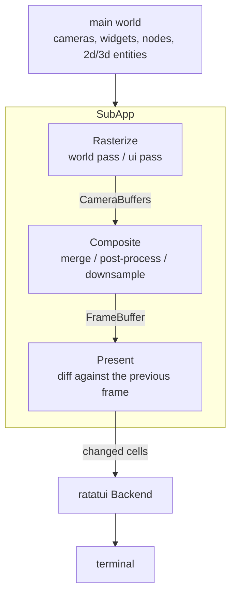

# Plurimus Architecture

Plurimus is a Bevy-native terminal renderer: a workspace of crates that render
Bevy worlds to terminal cells. The cell model is ratatui's - `Buffer`, `Cell`,
`Rect`, `Style` from ratatui-core - and the rendering model is Bevy's: any
number of systems produce drawable data throughout the frame, and exactly one
presenter writes to the terminal.

Every frame flows through the same pipeline. Terminal-relevant data is extracted
from the main world into a dedicated terminal render sub-app; pipelines
rasterize that data into per-camera buffers (world-space pipelines first, the ui
pass on top); the compositor merges camera buffers into a single frame buffer in
camera order and downsamples it to the terminal's color depth; and the presenter
diffs the composed frame against the previous one, writing only the changed
cells through a ratatui `Backend`. Multiple `TerminalCamera`s with cell-space
viewports split the terminal the way multiple cameras split a window - a map
view, a sidebar, and a minimap are three cameras with three viewports.

Consumers adopt the workspace in tiers. Core alone renders to any `Backend`;
adding input and crossterm gives a live terminal, or adding input and the web
tier a browser page; the ui, widgets, and bevy-ui tiers add interaction and
controls; the 2d and 3d pipelines draw world-space entities. Each tier is a
feature on the facade crate and a crate of its own.

## Crate Organization

### plurimus

The facade crate. Feature-gated re-exports of the member crates and nothing
else: `plurimus_core` is unconditional, and each feature enables one member
crate and its module (`crossterm` and `web` imply `term`; `widgets` and
`bevy-ui` imply `ui`). The default feature set is `crossterm` - core, term, and
a live terminal. The facade crate also hosts the runnable examples, and `ratman`
and `lander` pick their backend by target, so each is also a browser demo;
`examples/` is the static site a hand-run Pages workflow publishes them from.
`todo` picks its target by flag instead, running one `bevy_ui` tree in the
terminal or in a bevy window, so the windowed stack - `bevy_winit`,
`bevy_render`, `bevy_ui_render` and what they lean on - is a dev-dependency of
the facade alone.

### plurimus_core

The render pipeline, and nothing else. Everything here means something against
any ratatui `Backend` - a test harness, a GPU surface, a file - so nothing
needing a real terminal lives here and no crate that does is depended on; the
`headless` example holds that line by building with the terminal tiers off.
`CorePlugin` installs the terminal render sub-app through `bevy_extract`'s
`ExtractPlugin`, so extraction is bevy's: its `ExtractSchedule` reads the main
world through `Extract`, which keeps each query's state across frames, the
resources the pipeline needs are `ExtractResource`s, and what extraction spawns
is a `TemporaryEntity` carrying the `MainEntity` it was drawn from, living for
one frame's render. The `TerminalRender` schedule then applies extraction's
commands, runs its three phases - `Rasterize` (pipelines write cells into
`CameraBuffer`s, world-space passes beneath the ui pass), `Composite` (camera
buffers merge into the `FrameBuffer` in camera order, apps post-process the
composed frame in `CompositeSystems::PostProcess` while colors are still what
the widgets chose, then colors downsample to the terminal's `ColorDepth`), and
`Present` - and despawns the frame's temporaries. A terminal camera is a bevy
`Camera`: `TerminalCamera` requires it and says only where in the cell grid the
view sits - the whole terminal, a fixed rect, a strip docked to an edge, or what
the docks leave - resolved each frame against `TerminalSize` into
`ResolvedViewport` in `(order, entity)` sequence, while compositing order,
activity and what untouched cells become are `Camera`'s own `order`, `is_active`
and `clear_color`, a `Custom` colour pre-filling the view and `None` letting
lower cameras show through. The same pass mirrors the rect and the terminal size
into `Camera` in `CellSize` pixels for every camera but a `Camera3d`, and fits a
`Projection` the camera carries to that view and its `clip_from_view`, as
bevy_render's `camera_system` would, so bevy_ui lays out, bevy_picking casts and
a 2d camera projects against terminal viewports as against a window. A
`Camera3d` renders to an image and is bevy_render's, sized from that image, so
the two writers split every 3d camera off from its first frame; a projected
terminal camera in an app that also installs bevy_render is written by both,
bevy_render's sizing it against the primary window, which agrees where that
window is the one `plurimus_term` lends. Core's mirror and that window take
their pixels from one formula, `CellSize::pixels`. Core also owns the subcell
raster primitives in `raster` (halfblock and braille grids, blits, color
averaging, `ColorDepth` downsampling), and the widget primitive: a `UiWidget`
placed by `UiArea`/`UiCamera`/`UiOrder` is extracted and drawn in one z-sorted
pass with no other crate involved, sorted by order, then source entity, then a
layer - the seam a pipeline drawing what a widget frames joins at, spawning its
own `ExtractedWidget` at the widget's source and a higher layer so it sorts
directly after it. Its `Default` draws nothing, which is what a widget holds
before its first restyle replaces it, so no widget library needs a blank of its
own. Which camera a widget draws on, the crates agree on rather than each
deriving: a `Propagate<UiCamera>` names it for an entity and everything beneath,
bevy's hierarchy propagation lands `UiCamera` on what it reaches with a nearer
one winning, and `ComputedUiCamera` is resolved once a frame in
`CameraSystems::PropagateCameras` as that or else the default camera - so a
child sits on its parent's camera without being told, and forgetting to say
stops being a silent misplacement. Whether it draws at all is agreed the same
way: a `Propagate<Hidden>` hides everything beneath it, and `Hidden` is what the
propagation marks it with - once in `PropagateCameras` so input routes against
it, and again in `Last`, where the same propagation runs a second time so a
subtree hidden during the frame is not drawn by it. Every reader reads the
landed marker, which is what lets a popover or a menu be hidden by its root
alone. `UiArea` requires it, local to what being half of where;
`CameraViewports` carries a camera to its viewport with the same default
fallback, and `local_area` is `resolve_area`'s inverse, for a crate holding a
screen rect that has to be stored camera-locally. `PresenterPlugin<B>` diffs the
composed frame and writes changed cells through any ratatui-core `Backend`, and
applies `TerminalCursor` - the terminal's own caret, which a screen reader
follows and an input method anchors to - outside that diff, because a caret
crossing a cell changes no cell's content and the diff skips a frame where
nothing differs. Drawing moves the terminal's cursor to the last cell written,
so a frame that draws puts a shown cursor back as well, in the same flush.
Position and visibility go through `Backend`; the shape is a backend's to serve.
Re-exports `ratatui_core`.

### plurimus_term

The terminal contract, both directions: everything that needs a real terminal to
mean anything. Inbound, a backend reports what its terminal said through
`TerminalInput` - a key down, repeated or up, a button, a move, a wheel notch,
each at a cell and with the modifier bits a terminal sends beside every event,
and focus gained or lost - and the sink writes what `bevy_winit` would have for
a virtual primary window: bevy's own `KeyboardInput`, `MouseButtonInput`,
`MouseWheel`, `CursorMoved` and `WindowFocused`, each once as itself and once in
the ordered `WindowEvent` stream `bevy_picking` reads. A terminal reports less
than a window does, and the sink fills the gap from the terminal's own facts:
the physical key is inferred from the logical one by `physical_code` - an ASCII
letter or digit is its own key whatever its case, so a hold shifted midway still
ends on `KeyW`; a named key is its namesake; a modifier lands on its left side,
the bits carrying none - and a character press carries its text. The pointer
sits at the cell's centre in `CellSize` pixels, a `CursorMoved` written only
when the cell changes, so a click lands where it happened with no move ahead of
it, and a wheel notch is one cell in pixels, so a node scrolls a row per notch
as a widget does. `PasteMessage` and `TerminalResized` are the crate's own,
there being no bevy message for either. What a terminal reports and a window
does not is `KeyModifiers`, the bits on every event: `PointerModifiers` keeps
the ones sent with the frame's button press, since bevy's pointer events have no
field for them, and `HeldModifiers` polls bevy's `ButtonInput<KeyCode>` back
into the same type for a key observer, bevy's `KeyboardInput` carrying none
either. On a terminal reporting modifiers only as bits -
`InputCapabilities::modifier_keys` unset - the sink writes the modifier key
presses and releases those bits imply ahead of the event that carried them, so a
shift-click holds `ShiftLeft` as a kitty terminal's own shift key would; one
table of the six modifiers serves that synthesis and the polling, so neither can
disagree about which keys drive which flag.

Input runs in `First`: `InputSystems::Pump`, where a backend drains its source
into the sink, then `Synthesize`, chained after bevy's clock and message swap,
and `plurimus_ui` orders both before `bevy_picking` reads the stream later in
the same schedule, so a pump never lags it a frame. `PendingInput` is the one
rule the sink applies to what it writes: a press or a release ends the frame's
batch for pointer input, and what follows waits in `Last` to land for the whole
of the next frame, because bevy hit-tests once a frame at the pointer's final
position and sends a click against that frame's maps - so a release lands at its
own cell against the state the press left, the menu a press opened or the widget
a press captured. Keys and focus flow. `TermPlugin` installs bevy's
`InputPlugin` and `TimePlugin` where the app has not, and requires `CorePlugin`
first, since applying a resize writes core's `TerminalSize`. Where the app
opened no window it spawns a `VirtualWindow` and keeps it at that size in
`CellSize` pixels, reporting each change as `bevy_winit` reports a resize, so
whatever reads a window's size - an upstream dialog's drag, bevy_render's camera
sizing - reads the terminal's; a window the app opened itself is never resized.

Synthesis is the input no terminal sends. `InputCapabilities` records what the
active backend can report - real key releases, and modifier keys as keys: the
kitty keyboard protocol tier - and where releases are absent a press is expired
on a `ReleaseTimeout` from a `HeldKeys` registry keyed by physical code. Losing
focus is the gap no capability covers, since a terminal reports nothing at all
while unfocused: every held key is released, a `KeyboardFocusLost` beside the
releases as `bevy_winit` sends one, and every held button is dropped from
`ButtonInput<MouseButton>` after bevy applies the frame's presses, as bevy drops
the keys - no button release is written, because `bevy_picking` would complete a
click nobody made from one, where `plurimus_ui` cancels the gesture instead.
Both key paths drain the one registry, which is why recording into it is a
system of its own rather than the first half of the timeout's: what is held has
to be known on every tier, and only the expiry is a capability's to turn off. A
synthetic release carries no modifiers and names the key as held, which is what
a terminal does too - an event reports the state it leaves behind. A click count
is the other fact no terminal reports, and it lives in `bevy_picking`, bounded
by `PickingSettings::multi_click_interval`.

Outbound it defines `TerminalRequest`, the one-shot side effects an app asks of
whichever backend is installed - copy to a clipboard selection, set the window
title - and `TerminalCursorStyle`, the shape it asks the caret to take, which no
ratatui `Backend` method can express. That stream is one-way, so `LastCopied` is
the state derived from it: a stock system in `RequestSystems::Echo` records the
last copy bound for the ordinary clipboard, giving a paste key one answer across
every widget that asks, and `Clipboard` is the system parameter over both
halves, so every widget that copies or pastes says it the same way. It echoes
what was requested rather than what the terminal holds, and runs in `Last` so it
sees every request the frame wrote; a backend reads the stream through a cursor
of its own during extraction rather than consuming it, so the echo, the backend
and any app reader all see the same requests. Re-exports `bevy_input`.

### plurimus_crossterm

The real terminal. `CrosstermPlugin` takes over the terminal on build - raw
mode, alternate screen, mouse capture, bracketed paste, the kitty keyboard
protocol when the terminal supports it, focus reporting - and restores all of it
on exit or panic, a takeover failing partway included, resetting the cursor
shape too when the app changed it and handing back the title through the
terminal's own title stack, since the escape reading it back is widely disabled.
A panic restores twice, from its hook and again as the app drops, and the second
pops nothing. It detects color support from the environment, pumps crossterm
events into `plurimus_term`'s sink and `TerminalResized`, and hands a
`CrosstermBackend` (via ratatui-crossterm) to core's presenter. The pump is
where a terminal's own encoding is normalized away, because a message cannot be
un-written once emitted and only the writer still has the whole drained batch: a
held key reported as a release followed by its own press becomes one repeat, and
a shifted letter keeps the shift bit the kitty protocol drops in favour of the
shifted character. Which encoding a terminal uses is learned from what it sends
rather than probed, since no crossterm query distinguishes them, and so is what
it reports: the kitty query decides only whether the protocol's flags are
pushed, and `InputCapabilities` counts releases and modifier keys as reported
once the first of each arrives, because a terminal answering the query can still
ignore the flags. Going the other way it serves `TerminalRequest` during
extraction - which runs inside the sub-app world with the main world lent in, so
one system reaches both the messages and the writer - and sets the cursor shape,
which no `Backend` method reaches. Both flush themselves, since the presenter
skips its flush on a frame where no cell differs. The writer is generic: stdout
by default, or the controlling terminal directly via `CrosstermPlugin::tty()`.

### plurimus_web

The browser, in `plurimus_crossterm`'s place. `WebPlugin` draws on a WebGL2
canvas - ratzilla's backend, over beamterm - mounted in an element of the page,
which it fills and follows as that element resizes. That backend holds browser
handles and so is not `Send`, which core's presenter asks for; the crate
satisfies the bound by refusing to compile for wasm with threads, so exactly one
thread exists and nothing is ever sent, rather than core growing a second
presenter path. The browser half builds only for `wasm32-unknown-unknown`; on
other targets the crate is `GridFit` and the pure mappings its tests exercise.

A page gives no blocking loop, so the plugin installs a `requestAnimationFrame`
runner that holds the first update until every plugin is ready - the page's
font, loaded asynchronously, and for a 3d app a GPU device created the same way.
The backend cannot exist before the font does, so the plugin builds it in
`finish` and adds core's presenter from there, which bevy accepts until every
plugin has finished; a test pins that. The font size is chosen once, from a
`GridFit`: a size, a column count, or the largest whole size whose grid still
holds a minimum, solved against a copy of the renderer's own cell measurement,
since the renderer's atlas is fixed when it is built. A later resize changes the
grid, not the font, and a mismatch between the copy and the renderer's cell is
warned about as upstream drift.

Input comes from the plugin's own listeners on the canvas rather than
ratzilla's, which report key presses alone. Keys arrive as presses, repeats and
real releases, modifier keys as keys, so `InputCapabilities` claims both - a
release lost to a focus change is covered by the blur that caused it. While the
canvas has focus every key is kept from the browser except a passthrough list
(reload and devtools by default), so Tab, arrows and chords reach the app. The
pointer is captured on press, so a drag keeps reporting past the canvas, and
lands in cells by the renderer's own cell size; wheel deltas become notches with
the remainder carried, and paste and focus become their messages. Listeners
queue what they see and a pump writes it in `InputSystems::Pump`, where
crossterm's pump writes, placing pointers against that frame's grid.

Outbound, extraction does what a terminal's resize event would: it follows the
canvas into the grid and the grid into `TerminalResized` every frame, since the
renderer notices a new size only when it flushes and the presenter skips
flushing an unchanged frame. `TerminalRequest` is served there too - clipboard
copies through `bevy_clipboard`, the primary selection having no browser
counterpart, and titles to the page, whose original title is restored on exit.
An exit stops the runner and dispatches `plurimus-exit` from the canvas with the
exit code, bubbling, since the canvas is mounted only after a page's script has
run and a page listens on the document instead; a tab has nothing to exit to,
and what leaving means is the page's to decide.

### plurimus_ui

Interaction over anything with an area. `UiPlugin` computes
`ComputedWidgetArea`s and is the `bevy_picking` backend for them: each frame it
reports the widgets under the pointer, per terminal camera, as one `PointerHits`
ordered just above bevy_ui's nodes on that camera and sorted by z-order, so
bevy's hover map, pointer capture, pointer events and click counts are the
pointer vocabulary a widget observes, around two ordered phases of this crate's
own - `Areas`, before `PickingSystems::Backend`, and `Route`, after
`PickingSystems::Hover`. The pointer is bevy's own: `UiPlugin` installs
`bevy_picking`'s `PointerInputPlugin`, mouse on and touch off, which raises the
mouse pointer from the window events `plurimus_term`'s sink writes, and orders
the terminal's input ahead of its reading so a pump never lags it a frame; a
cell is a pointer at its centre in `CellSize` pixels, and the batch a press ends
is the sink's rule, so what follows a press lands a frame later against the
state the press left. A primary press on a widget captures the pointer to it
through `PointerCaptureMap`, so its drag and release reach it wherever the
pointer goes, and marks it `Pressed` - all but the widgets `bevy_ui_widgets`'
own observers drive, which `UiPlugin` installs (every fontless plugin, and the
`UiScale` three of them read): a `Button`, `Checkbox`, `RadioButton`, `Tab` or
`MenuItem` presses, releases and clicks by bevy's hover map, as a node does, so
a release off one lands off it. `click_cell` is how a widget tells a click that
ended on it from one that did not, and `pointer_cell` reads the cell under any
pointer event, both from the event's live position rather than its hit, which
under capture is the press's. What a press may do is a two-marker vocabulary
beside bevy's `Pickable`: an `InteractionDisabled` widget is inert rather than
invisible - it is still a hit, so it blocks what is beneath, but no gesture
starts on it and its press goes no higher - while wheel ticks still fall through
it, consuming being the wheel router's own opt-in; `Pickable::IGNORE` is
transparency, the widget keeping its area for nothing the pointer does; and
`PressFocusDisabled` suppresses only the focus a press would move, so a toolbar
control is tab-reachable without a click on it taking the keyboard. Disabled
reaches a widget's descendants as hidden does, through `ComputedDisabled`,
resolved in `Areas` and read on every input path and by the stylists alike, so a
disabled container is inert inside rather than merely drawn so; the same pass
writes `InteractionDisabled` onto what it reaches, since upstream's observers
read the entity's own flag alone, and takes back only what it wrote. Focus
otherwise follows a press to the first `TabIndex` carrier at or above what it
lands on - a part of a widget focuses the widget - stopping at
`PressFocusDisabled`, whose promise covers what is inside it but an upstream
`Checkbox`, whose own press handler focuses it and is ordered after nothing, and
at an open overlay's root, whose opener lies outside it; a walk that finds none,
or a press on nothing, which window picking reports as a press on the window,
clears focus as it does on a desktop. Click counts are bevy's, per widget on the
wall clock within `PickingSettings::multi_click_interval`, so a second press
anywhere on the same widget runs with the first and a press on another widget
starts over. What bevy's pointer events do not carry is `plurimus_term`'s
`PointerModifiers`, the modifiers the terminal reported with the frame's button
press, which a widget reads beside the event. A focus loss cancels the captured
gesture: this crate writes the `PointerInput::Cancel` bevy raises for no mouse,
at the cell the pointer last reached, and since the hover map is emptied for a
cancelled pointer before its events run - so bevy's own cancel reaches nothing,
and one landing with a press would swallow the press - it sends the
`PointerCancel` to the captured widget itself, or with nothing captured to every
pressed widget, clearing its `Pressed`, and holds a cancel that shares a frame
with a press or a release back to the frame's end, where it lands ahead of what
the press held back. It installs focus via `bevy_input_focus` and pins the
dispatch into that sequence - after `bevy_input`'s own update and between
`Areas` and `PickingSystems::Hover` - so a focused-input observer reads this
frame's areas and settled key state rather than whatever the schedule happened
to resolve; work that must see what one did is ordered after the dispatch, which
is what `plurimus_widgets` does with `WidgetSystems::Layout`, itself before the
backend so the rows and items it places are hit-tested in the frame they move.
It also builds the directional navigation map from the widget areas of every
non-negative `TabIndex`, so a roving strip is one arrow target, as it is one Tab
stop - all but upstream's text field, a node whose area is there only to place
its caret, nodes taking no part in arrow navigation - and provides scrolling
(`ScrollArea`, `ScrollOffset`, `ScrollIntoView`) with cached extraction of
scrolled content, plus the generic modal-overlay primitives (`ModalOpen`,
`ModalDismiss`) an app builds its own overlays from. What "inside a modal" means
is the overlay's own rect, for the pointer and the wheel alike: a position an
open overlay covers admits that overlay's subtree and nothing else, so an
overlay confines input rather than depending on every child of it being marked,
and outside every open overlay the one thing picked is a barrier entity above
everything, whose press dismisses them and beneath which nothing is reached -
nodes included, since the barrier blocks bevy_ui's picks as a widget does. A
press on a `ModalityToggle` is where geometry cannot answer, since an opener
sits outside the overlay it closes: an enabled toggle is picked in the barrier's
place and dismisses only the overlays it does not own, those rooted beneath it,
so an opener closes its own overlay by toggling it and switches away from a
neighbour's. Taking the union of the overlays covering a position is what admits
a submenu inside its parent without ordering modal roots against each other.
Every scroll converges on one event: a wheel tick, routed by this crate from the
frame's `PointerInput` at its own cell, arbitrated by z-order among the
`WheelReceptive` widgets under it that an open overlay admits and that can still
use that axis - a `ScrollArea` measured against its content at the tick, any
other receptive widget taken at its word - with a tick outside every open
overlay dismissing them instead, becomes a `ScrollBy`, which whoever stores the
scroll consumes - this crate's `ScrollOffset`, a bevy_ui node's own position, a
text editor's engine viewport - each clamping the step against its own extent;
an app's own key handler sends the same event. `WheelReceptive` requires
`Hovered`, which is what makes a widget a pick, so a tick over it never also
reaches a node it is drawn over. The `(KeyBinding, Action)` bindings components
share `first_bound`, the scan this crate owns so a widget family written
elsewhere states "first match wins" by calling it rather than by copying it -
the table's and the two text widgets', the widgets upstream has no counterpart
for, and a list's one copy key. The table consumes a motion key only when it
changes something, so an arrow pressed at an edge falls through to directional
navigation, which ignores repeats so that a held key stops there instead;
upstream's slider, list and tab bar consume every key they bind. A `KeyBinding`
is a `Key` and the `KeyModifiers` it must be pressed under, and
`KeyBinding::matches` is the one rule: every modifier but shift exactly, and
shift exactly for a named key but only when asked for on a character, since a
shifted symbol carries the bit on some terminals and not others. The modifiers
it is checked against are polled through `plurimus_term`'s `HeldModifiers`,
bevy's `KeyboardInput` carrying none of its own. `content_cell` is where a
pointer cell becomes a content cell for any of it, clamping into the area so a
captured drag past an edge keeps addressing the nearest one; `screen_cell` is
the way back, refusing rather than clamping, and it is what places the focused
widget's `WidgetCursor` on the terminal - a cursor whose cell is `None` names
none, which is how a widget with nowhere to put its caret says so without
discarding the shape an app gave it. Both take the scroll offset as the
`ScrollOffset` a widget may or may not carry, because a widget carrying none is
scrolled to the origin and that is the crate's rule to state rather than every
caller's to know; scroll state kept anywhere else is put in one to ask.

The interaction vocabulary itself is bevy's: `Hovered` is `bevy_picking`'s,
`Pressed`, `Checked`, `Selected` and `InteractionDisabled` are `bevy_ui`'s, and
`Activate` and `ValueChange` are `bevy_ui_widgets`'s, re-exported rather than
mirrored, so a widget on a node and a widget at a cell rect report the same
state in the same type and an app's skin reads one. The events are bevy's too -
`PointerPress`, `PointerDrag`, `PointerRelease`, `PointerClick`,
`PointerCancel` - reached through this crate's `bevy_picking` re-export, and
`Hovered` has bevy's one writer: true on the topmost widget under the pointer
and its ancestors, a disabled widget included while it blocks, which the
stylists resolve beneath disabled.

It also owns the styling contract entire, so a widget library reaches it without
depending on another widget library. `UiPlugin` initializes the `UiTheme`
resource, `UiTheme::resolve` turns an `InteractionState` into the one `Style`
its documented precedence gives - disabled over pressed over hovered over
normal, focused patched over the winner - and `UiStyle` and `StylistDisabled`
are the two escapes from it. `UiTheme::caret` and `UiTheme::selection` are the
terms `resolve` does not answer, a caret or a selection a widget draws into its
own cells being a thing inside the widget rather than a state the widget is in;
whoever draws one patches it over the characters it covers. Beside that
vocabulary sits the engine that consumes it: `StylistCache` records what a
widget last drew and `StylistCache::redraws` is the compare-and-swap every
stylist gates on, so a theme swap, an edited label, or a dirtied container
repaints and an idle frame costs a comparison. Handing an entity back from
`StylistDisabled` repaints it too, by a removal hook that resets its cache - the
entity sat outside every stylist query and so missed whatever landed meanwhile.
`observed` reads an entity's state through `StateQuery` and
`StylistCache::with_value` carries the hash a widget's own value contributes,
for a stylist that resolves its state rather than reading it; `restyle` runs the
whole loop for the label-driven case, and a `UiLabel` is a ratatui `Line`, so a
label carries per-span style of its own. Re-exports `tui_scrollview`;
`bevy_input_focus`, whose focus types and dispatch set are part of this
contract; and `bevy_input`'s `Key`, the type its bindings are written in.

The single-line text engine is this crate's too, so every host of a field edits
and draws through one: `TextInput` owns a value, a cursor resting on
grapheme-cluster boundaries and the selection's other end; `handle` and `paste`
apply a key or pasted text to it, `apply` one `TextInputAction`, and `TextRow`
draws it in one row windowed to keep the caret in view, its caret patched only
while focused and nothing is selected. `plurimus_widgets`' cell `TextField` and
`plurimus_bui`'s node field are both hosts of it, and `unbound_text` and the
cluster steps are the rules a multi-line editor shares, so a chord types into no
text widget and a step crosses whole clusters in all of them.

### plurimus_widgets

The widget library, mirroring bevy_ui_widgets where upstream has a counterpart:
its component vocabulary and event contract over terminal-native engines.
Buttons, checkboxes, radio groups, sliders, scrollbars, list boxes, tab bars,
panes, menus, popovers, a single-line `TextField`, and a multi-line `TextEditor`
built on ratatui-textarea; `Table` is past the parity list, upstream having none
to mirror. The two text widgets, the list box and the table are the ones that
talk to the clipboard: the text widgets' copy and cut and the list box's and
table's copy offer the text to the terminal, and the text widgets' paste inserts
`plurimus_term`'s `LastCopied`, read at the press, so a copy anywhere is a paste
in either text widget. The editor's copy and cut fill its engine's own kill ring
as well, which only its separate yank reads, beside what a line or word deletion
puts there; a masked field copies nothing. The single-line field's engine is
`plurimus_ui`'s `TextInput`, published so a host routing its own keys drives a
field it never focuses rather than rewriting the cluster stepping that is the
hard part. What the stock observers add around `TextInput::handle` and
`TextInput::paste` is dispatch and policy, which is why the core leaves Enter
and the clipboard's keys untaken, the field having no clipboard to reach.
Enter's press emits the final `ValueChange` and a `Submit` carrying the value, a
repeat emits neither since one intent commits once, and focus loss still emits
that final `ValueChange` alone - which is the whole of what tells committing an
entry from abandoning one. Its caret is drawn only while it holds focus and
nothing is selected, so a screenful of fields shows the one the keys reach, and
the same cell is published as its `WidgetCursor`, so the terminal's own caret -
the one a screen reader follows - sits there too, as a bar by default, since a
block inverting its cell cancels the reversed one drawn beneath it; an app
taking the field's look with `StylistDisabled` takes that cell with it. Most
widgets are stateless controllers emitting entity events (`Activate`,
`ValueChange`); apps apply them, or attach the stock `*_self_update` observers
for uncontrolled behavior. The button, checkbox, radio group, slider, list box,
tab bar and menu are `bevy_ui_widgets`' own types, driven by upstream's
observers and following its models, so a cell widget and a node answer one rule:
a click ending on it, or upstream's keys by physical key, unmodified and
unremappable, while it holds focus. What is the crate's is the constructor, the
stylist, the placement, and the pointer routing a cell rect needs where
upstream's measures a node - the slider's seek and scrub, and the row a list's
press, drag and click land on, which a click hands upstream through
`SetSelected`. The bundles carry the `Hovered` and `StylistCache` upstream's
markers do not require. The radio group is upstream's model too: the group is
the tab stop and the addressable value, a press on an option focuses it, its
arrows move the check and wrap, and the checked option is drawn focused while
the group holds it; `radio_group()` carries a widget drawing nothing so
directional navigation reaches the group, at the `UiArea` its app gives it. A
menu is upstream's model whole: its button asks for the popup through a bubbling
`MenuEvent`, the open popup takes focus onto its first or last item, and it
closes when focus leaves it, so a press outside closes the menu and still acts
on what it hit. Upstream leaves answering that event to the app; this crate
answers it for a popup holding its `Popover`, showing and hiding it through
`Propagate<Hidden>`, and leaves a menu of nodes to its own app. The popup is a
pick that stops the focus walk and takes wheel ticks, so a press on its frame
keeps focus inside and a tick over it scrolls nothing beneath.

A `Popover` is placed against its anchor's resolved area every frame, so it
follows a moving anchor without being told, and a press or a click inside it
goes no higher than it: drawn apart from what it is a child of, it is no part of
that entity, so a menu parented to its button never presses or activates the
button. Two fields say what following means: `cell` narrows the anchor to one
cell of its content - mapped through the anchor's own `ScrollOffset` by
`plurimus_ui`'s `screen_cell`, so an editor names its caret once, in the
component it already publishes it in - and `camera` names the camera the popover
draws on and is bounded by when that should not be its anchor's. They compose
because the anchor's rect resolves in screen space before any camera is
consulted, and each is one input to the same placement rather than a path of its
own: the side, the mirror when it will not fit, the alignment and the clamp are
the code that was already there, applied to a one-cell rect or against a
different viewport. Both say "nowhere" the same way, with `Rect::ZERO`, for a
cell scrolled out of its anchor's window, an anchor drawing nothing, and a
camera with no viewport this frame alike, because attaching to something
invisible is what a popover has no answer for. `camera` is a field rather than a
user-set `Propagate<UiCamera>` because placement writes that propagation itself,
to reach the popover's children, and so could not tell an app's from its own;
the anchor still gates adoption, so a popover with no anchor to be placed
against takes no camera either. Every side attaches to an outer edge, which is
why `PopoverSide` has four variants and not five: a box drawn _inside_ its
anchor has no side to mirror and no edge to align to, and is a child holding a
`UiArea::Fixed` placed through `local_area`.

A `TabBar` is a marker requiring upstream's `TabList`, whose `Tab` children are
the tab stops: one rests on a roving `TabIndex`, the arrows along the bar move
focus among them and wrap, Enter or space selects under the default `Manual`
activation and moving focus does under `Automatic`, and the selection is the
list's `SelectedTab`, mirrored onto its tabs as `Selected` in `PostUpdate`, and
changed only by a `ValueChange<Option<Entity>>` on the list that
`tablist_self_update` applies. What is the crate's is placement and drawing. The
tabs are placed by the bar, one rect each along `TabList::orientation` in child
order, written to their `UiArea` and `ComputedWidgetArea` in
`WidgetSystems::Layout` the way menu rows are, with an `UiOrder` one above the
bar's so a label is never under the chrome; that pass runs only when the bar's
area, look, list, children or order changed or a label did, and a hidden bar's
area is already zero, which places its tabs nowhere. Being placed, a tab is
picked, so upstream's own click observer finds it under a click. `TabBarLook` is
composable fields rather than variants - `border`, `divider`, `padding`,
`joined` - and `thickness()` is one cell or three. The bar draws chrome and each
tab draws itself: the bar's stylist fills its area, resolved focused while focus
is within it, draws the divider in each gap and, when `joined` names an edge
across the bar's axis in a border that has a `line::Set`, a baseline along that
edge; it redraws on `ContentDirty`, marked by `mark_dirty_content` when a tab's
rect, the children, the look or the list change. A tab's stylist reads the
parent's look and active style, resolves focused when the tab holds focus, and
patches `TabBarActiveStyle` over the selected tab, beneath its own `UiStyle`,
frame and label alike. A boxed tab is a `Block` with ratatui's padding; on a
joined look the selected box clears its joined edge and turns its two corners
outward while every closed box tees its corners into the baseline, glyphs taken
from the `line::Set` matching the `BorderType`, which is why the quadrant
borders draw closed.

A stylist rebuilds a widget's `UiWidget` from `plurimus_ui`'s `UiTheme` when the
state it last drew differs from the current one, or when its label changed, not
every frame, and they run in the `WidgetSystems::Style` set an app orders its
own against. Only the stylists themselves are the crate's: the cache they gate
on, the state they read, the label they draw, and the theme vocabulary the app
speaks all belong to `plurimus_ui`, which is what lets a widget family outside
this workspace be written against the same engine. `StylistDisabled` exempts an
entity so an app takes its look while keeping its behavior, and `UiStyle`
patches over the style an entity would otherwise resolve to, on a widget or on
one list or table row.

The two widgets drawn from row children - the list box and the table - share
everything a container cannot work out for itself, which is why `rows` holds it
and depends on neither: the cursor (`ActiveDescendant`), the row decorations
(`ListItemText`, `ListItemTrailing`, `Marked`), and four generic passes in
`WidgetSystems::Layout`. Their rows are child entities, and a child's change
never marks its parent, so one pass forwards a row's change to the container
before any stylist runs - including a row losing a component, which no change
reports, so each container names every component it draws from its rows beside
the filter that watches them - and a second sums its rows' heights into the
scroll extent, reading that same signal so a row's edit resizes the content in
the frame it happens. A third keeps the cursor pointing at a live row -
filtering a list is despawning its rows, and a cursor naming a dead one
highlights nothing and moves from nowhere, so it re-points to the first
survivor, or to none when none survives, leaving a deliberately empty cursor
alone. A fourth scrolls whichever row the cursor names into view, which belongs
to the cursor rather than to the key that moved it: a click, a repair, and an
app driving the list from a search field beside it all reveal, where once only
the container's own key handler did. A stylist reads it too, rather than hashing
every row to find out, which is what keeps a settled list of any length free on
an idle frame. A row is one terminal row tall unless it carries `ListItemText`,
which only a list box draws: that row is as tall as its text has lines, and the
extent, the row a click lands in, and the reveal that keeps the cursor visible
all measure by height rather than by count. A list row's marker gutter lights
for `Selected` or for `Marked`, two channels because `Selected` is the selection
the stock updater writes and an app marking a row for a reason of its own must
not have that redefined under it; `ListItemTrailing` is right-aligned by the
list against a width only the list has, a row being built before the box is
placed. Both containers band their rows the same way - `ListBoxStripe`,
`TableStripe` - patched over every second row counting in child order, so
stripes do not crawl on scroll and a multi-line row counts once, beneath the
row's own `UiStyle` and the cursor's highlight; the two stylists share the rule
and not a type, their rows resolving in different shapes. Both copy by one rule
too: the cursor row, or every selected row of a multi-select container - a
list's `Selected`, a table's `Checked` - a single-select container's one
selected row being its last pick, left behind as the cursor moves on, and
`Marked` is not selection. Whichever container holds the cursor, the row it
names is styled as focused even when focus sits elsewhere - being driven is what
`ActiveDescendant` is for, and a cursor nobody can see is that pattern
contradicting itself. The cursor is upstream's `ActiveDescendant`, immutable, so
every writer inserts it and only when it moves, an unchanged insert counting as
a change that reveals the row again; a list's is cleared when it loses focus and
restored to its selected row when it gains it, as upstream's focus rule has it,
so a list is driven from elsewhere by inserting the cursor it should show. A
list's keys are upstream's, with copy on a fixed Ctrl+c beside them; the table
takes its movement and copy keys from `TableKeys`, a component of
`(KeyBinding, Action)` bindings, which is how an app remaps it to vim keys,
`Ctrl+D` included, without reimplementing movement beside the widget. Only the
bindings are the crate's: the scan itself is `plurimus_ui`'s `first_bound`.
Every widget here whose keys are its own takes them that way. The two text
widgets' tables - `TextInputKeys` and `TextEditorKeys` - bind editing rather
than movement, so an unbound unchorded character still types itself and an
unbound chord propagates. `TextInputAction`'s `Submit`, `Copy`, `Cut` and
`Paste` are the actions `TextInput::handle` refuses to apply - what committing
means and where a copy goes are the dispatcher's, so `handle` leaves them and
whoever routes the key acts on them, which is also why the enum stays closed.
The editor's actions carry the engine's own `CursorMove` and `Scrolling` rather
than restating them, and apply through its public operations rather than its
emacs keymap, which never runs: a table can unbind a key only if nothing behind
it still answers.

A `Table`'s rows are child entities holding their own cells, banded by
`TableHeader` and `TableFooter` and striped by `TableStripe`. Interaction is
opt-in: `TableSelection` makes the table a tab stop and chooses row, column, or
cell granularity. Selection lands on the release rather than the press, the
`PointerClick` resolved through `click_cell` to the cell it ended on, because
selecting usually closes what was clicked and closing on the way down despawns
the entity `bevy_picking` is still owed a release for; a header click reports
its column on the same edge so the app can sort - the crate supplies the
geometry and never the ordering. A list moves its cursor on press and drag, so
the highlight follows the pointer; a table does not, its cursor gutter existing
only while a row is current, so moving the cursor mid-gesture would shift the
columns the release resolves against. Because a scroll area windows a widget
whole, a scrolled table's bands scroll with its body. A cell is text in its row
rather than an entity, so nothing can be a child of one and
`TableGeometry::cell_rect` publishes where a cell is instead - a host floating a
field over that rect is how a cell is edited in place. It and the click router
resolve against one column solve, taken from the table's current state rather
than from what was last drawn, so the two agree whoever moved the cursor; and it
is why an unstated `TableColumns` is divided by this crate rather than by
ratatui, whose identical rule would answer to its own render area and so could
drift from the geometry that has been published.

Re-exports `ratatui_widgets`, `ratatui_textarea`, `bevy_input_focus`, and
`bevy_input`'s `Key`.

### plurimus_bui

The bevy_ui bridge, and the one place a bevy_ui tree meets terminal cells.
`BuiPlugin` runs bevy_ui's real layout stack - `Node` trees computed by taffy -
against the bevy `Camera`s core keeps on terminal cameras, at core's `CellSize`
pixels per cell, one by one by default, so a tree sized in a window's pixels
lays out the same here once the cell is named; the bridge adds only
`IsDefaultUiCamera` on core's default camera, since bevy_ui's own fallback picks
the highest order where plurimus picks the lowest. Only layout, stacking and
picking run: bevy_ui's font, focus and asset systems stay out. Text is bevy_ui's
own - `Text` roots with `TextSpan` children, read through `TextUiReader` -
measured by grapheme width rather than by a font, one row tall whatever its
size, with weight, style, strikethrough, underline and colour mapped onto the
cell's modifiers and foreground and everything a cell cannot show ignored; a rem
is a row, so `Val::Rem(1)` is one line here as on a window. `Visibility` is
propagated into `InheritedVisibility` by the crate itself, since bevy_camera's
propagation brings culling with it, and `Outline` draws as a one-cell ring.
Computed nodes rasterize in the terminal sub-app in bevy_ui's own `UiStack`
order, which the crate computes because the upstream system is private, and
where they sit among widgets the tree decides: a node under no widget draws
beneath every widget, and the nodes beneath a widget in the tree draw directly
after it, in its band, as one extracted widget of their own - so a `Text` inside
the frame an overlay's widget clears is readable, as a child drawn over its
parent is on a window. A node carrying a widget of its own is not lifted, that
widget being what draws there, which is what keeps a label mirrored on a
button's entity beneath the button.

Interaction is bevy's, not plurimus_ui's, and so is the pointer: `BuiPlugin`
installs bevy_ui's picking backend beside the widget backend `UiPlugin` already
runs, on the one mouse pointer `bevy_picking` raises from the terminal's window
events, and the fontless `bevy_ui_widgets` plugins `UiPlugin` installs make
upstream buttons, checkboxes, sliders, menus and scroll areas run on nodes
unchanged, while `PointerFocusPlugin` stays out because plurimus_ui's press
already moves focus and a second writer would race it. `TextInputPlugin` is the
bridge's to add, and upstream's `TextInput` is the text field on both targets:
its observers queue the edits a window's font engine would apply, the bridge
applies them to `plurimus_ui`'s text engine instead and writes the value back
into `EditableText`, so an app reads and clears one field the same way on
either, and the field draws one row through the engine's `TextRow`, coloured by
its `TextCursorStyle` where it carries one, and publishes its caret as a
`WidgetCursor`. A press lands on the cluster drawn in its cell, measured from
the node's own rounded content edge. The two backends share one terminal by
bevy's own rule: a camera's widget hits are ordered above its node hits and
block what is beneath, so a widget drawn over a node takes the press and the
hover and the node gets neither, as a window's stacking would have it; a wheel
tick is the exception, routed by plurimus_ui among its receptive widgets alone
and reaching a node only where no widget is picked at all. An open plurimus
overlay confines nodes as it confines widgets: inside it only its own subtree is
picked, so an overlay built of nodes works and one drawn over nodes covers them,
and outside it the barrier is the one pick, so nothing is reached and a press
dismisses. Window picking stays on, so a press on no node and no widget is a
press on the window and clears focus as it does on a desktop. A tree shared with
a windowed build keeps arrow-key navigation to each target, which nothing builds
for nodes.

### plurimus_2d

The software 2d pipeline. `Glyph`, `GlyphBlock`, `Pixel`, and `PixelBlock`
entities positioned by `Transform`s are projected through every terminal camera
carrying bevy's `Camera2d` - its `OrthographicProjection`, fitted by core, and
`Camera::world_to_viewport` - and rasterized into camera buffers in the
world-space pass. A world unit is a pixel and a cell is `CellSize` pixels, so
the terminal cell's tall shape is the app's `CellSize` rather than a 2d setting,
and a sprite past the projection's near or far plane is not drawn. Glyphs and
pixels each draw in transform `z` order, pixels beneath all glyphs; `PixelBlock`
stamps a palette-indexed bitmap one pixel per subcell, so pixel art composes as
one entity. `SubcellMode` selects halfblock or braille resolution, and
`bevy_camera`'s `RenderLayers` masks which cameras see which entities.

### plurimus_3d

The GPU readback pipeline, and the only crate that pulls in bevy_render.
`Render3dPlugins` assembles a headless bevy render stack; a real 3d camera
renders to an image, `ReadbackFrame` carries the pixels back, and a `Strategy3d`
converts them to cells - halfblock colors, luminance ramps (ASCII, blocks,
braille, shading), depth ramps. Depth readback feeds `DepthOcclusion` for
cross-camera occlusion and `EdgeOverlay` for outline characters. The render
stack stops before materials: the app adds its own material system (`PbrPlugin`)
and asset loading such as `bevy_gltf`. Having no surface, the stack can take no
WebGL2 adapter, so on wasm it renders through WebGPU and a browser has to offer
one.

### plurimus_test

Dev-only test support; a dev-dependency everywhere, never shipped. Input
injection (`press_key`, `click`, and friends) reports through `plurimus_term`'s
own sink, exactly as a backend does, `clipboard_writes` reads back the copies an
app asked for the way a backend would, and
`composed_frame`/`composed_styled_frame` snapshot the composed `FrameBuffer`
straight out of the sub-app - so a test drives a full app headlessly with no
terminal and no presenter attached. `widget_content` hands back the drawable an
entity currently holds, which is how a test tells a redraw from a skipped one.

## External Crates

- **Bevy** (0.20) - the ECS and app foundation, consumed as granular crates and
  never the `bevy` umbrella: `bevy_app`, `bevy_ecs` and `bevy_camera`
  everywhere, the camera being bevy's from core up; `bevy_input`, `bevy_window`
  and `bevy_time` for the input contract, whose messages are bevy's own;
  `bevy_input_focus` for focus; `bevy_clipboard` for the browser's clipboard;
  `bevy_ui`, `bevy_text`, `bevy_picking` and `bevy_ui_widgets` for the layout
  bridge and the interaction vocabulary; `bevy_transform` and `bevy_math` for
  cell geometry and 2d; `bevy_extract` for the render sub-app, from core up; the
  render stack (`bevy_render`, `bevy_core_pipeline`, `bevy_image`, `bevy_mesh`,
  `bevy_light`, and friends) only in `plurimus_3d`; the windowed stack
  (`bevy_winit`, `bevy_ui_render`, `bevy_sprite_render`, `bevy_a11y`) only as a
  dev-dependency, for the `todo` example's window. Apps add whatever further
  bevy crates their scenes need at the same version, and cargo unifies them.
- **Ratatui** - the cell model and widget ecosystem: `ratatui-core` (0.1)
  supplies `Buffer`, `Cell`, `Rect`, `Style`, and the `Backend` seam;
  `ratatui-widgets` (0.3) the stock widget set; `ratatui-textarea` (0.9) the
  multi-line editor engine; `ratatui-crossterm` (0.1) the backend adapter the
  presenter drives.
- **crossterm** (0.29) - terminal control and the event source
  `plurimus_crossterm` translates from.
- **ratzilla** (0.3) - the WebGL2 `Backend`, over beamterm, that `plurimus_web`
  presents through; **wasm-bindgen**, **wasm-bindgen-futures** and **web-sys**
  reach the page itself.
- **tui-scrollview** (0.6) - scroll-area windowing underneath `plurimus_ui`'s
  scrolling.
- **unicode-segmentation** / **unicode-width** - grapheme segmentation and width
  measurement for text handling in cells.

The minimum supported Rust version is 1.97.1, the floor bevy 0.20's shader
compiler sets, declared once in `workspace.package` and verified in CI.

## Public API

The crates are published, so a public type is a commitment about what may change
under it. A type carries `#[non_exhaustive]` when the thing it models has an
open vocabulary - one terminals define, or pipeline phases, or an app's own
needs rather than a closed domain - so that gaining a field or a variant is a
minor release rather than a breaking one. Every sealed type keeps some way to be
built from outside - `Default` and public fields where that suffices, a
constructor where it does not, and a `const fn with_*` per field where the type
is built in a `const` context, which `KeyModifiers` and `InputCapabilities` are
the pattern for. An attribute that leaves a type unbuildable from outside is not
forward compatibility but a wall.

A type is deliberately left open when an app has to handle every case to be
correct: `ClipboardTarget`, `TableSelection`, `UiArea`, `PopoverSide`,
`PopoverAlign` and `Edge` are open for that reason, each saying so where it is
declared, because a consumer's exhaustive match failing to compile is the point

- a `_` arm would swallow a case it needs to decide about. Two categories are
  out of scope by construction, since neither can grow: unit markers, and tuple
  newtypes, where a second field is a redesign rather than an addition.

Traits are sealed only where a downstream implementation would be a mistake.
`TerminalRenderAppExt` is sealed, being an extension trait whose one sensible
implementor is bevy's `App`; sealing it is what lets a method appear as the
sub-app grows one - a registration as a phase lands, or `terminal_backend`, the
read that hands a headless app back the backend its presenter drew into, since
that backend lives in the sub-app where no main-world system can reach it.
`TerminalWidget` is deliberately open, because implementing it is how a widget
outside ratatui's `Widget` convention joins the pipeline - the `headless`
example does exactly that, and the blanket impl over `Widget for &Self` covers
everything else.

## Testing

Tests drive full apps headlessly. Because the presenter is `Backend`-generic and
`plurimus_test` reads the composed `FrameBuffer` directly from the render
sub-app, a test builds a real `App`, injects input as if a backend had
translated it, advances frames, and asserts on frame snapshots - no terminal
involved. Unit tests live in each crate; integration tests in `tests/` cover
cross-crate plugin composition; and every example is compiled as a test
(`test = true`), so the example suites are part of the workspace test run.

CI gates every change: `cargo fmt --all -- --check`,
`cargo clippy --workspace --all-targets --all-features -- -D warnings`,
`cargo test --workspace --all-features`, and
`RUSTDOCFLAGS="-D warnings" cargo doc --workspace --all-features --no-deps`,
plus `cargo hack check --each-feature` on the facade, a `cargo check` on the
MSRV toolchain, clippy on `wasm32-unknown-unknown` for `plurimus_web` and the
`web`, `ratman` and `lander` examples (whose browser code no native job
compiles), a check of `plurimus_web` on the MSRV, prettier and markdownlint over
the markdown, typos, cargo-deny, and cargo-semver-checks. Every Rust job but the
MSRV checks runs on the exact toolchain `rust-toolchain.toml` pins, with every
rustc warning denied, so a new clippy arrives as a deliberate bump rather than
as a red build. The GPU smoke tests are `#[ignore]`d because they need a wgpu
adapter; run `cargo test --workspace --all-features -- --ignored` when touching
the 3d stack - they are the only coverage of the headless render stack's plugin
composition.

Because clippy runs with `-D warnings`, the lint configuration is a gate rather
than advice. `[workspace.lints]`, inherited by every crate, warns `missing_docs`
and clippy's `pedantic` group alongside `style`, `complexity`, `perf`, and
`suspicious`, denies `correctness`, and selects `missing_const_for_fn` and
`redundant_clone` out of `nursery`. The lints a terminal renderer cannot honor
are allowed at the workspace with the reason inline: the four narrowing-cast
lints, `needless_pass_by_value`, `type_complexity`, `float_cmp`, and
`match_bool`. `clippy.toml` carries the hard tier of the project's size limits -
50 lines per function, 5 parameters, 5 levels of nesting - so a breach fails the
build; file length has no lint and is enforced by review.
